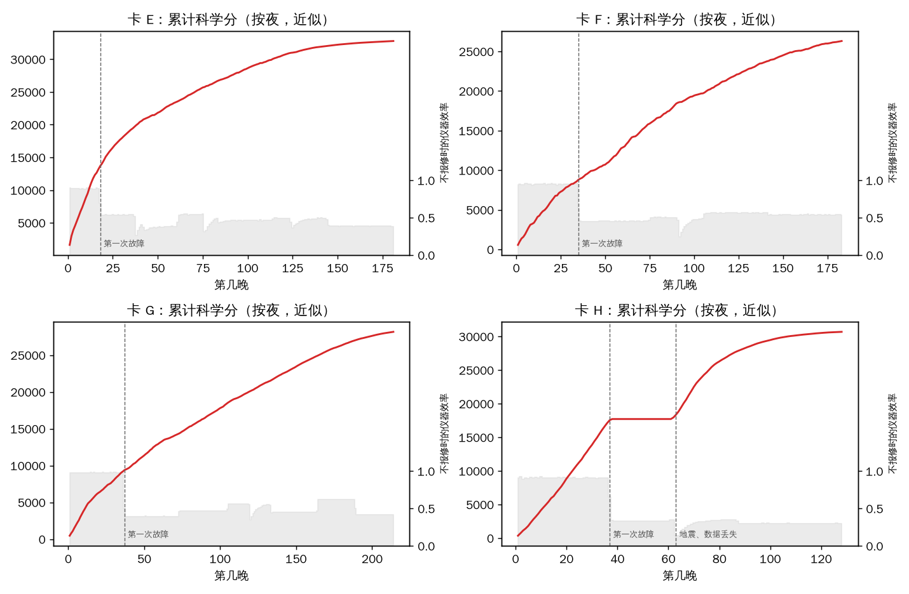

# 隐藏卡决赛（E–H）复盘

本文复盘最终版本 c48（revision `2b6c3000-16fc-4938-b044-782be063a66d`，源码即本目录的 `agent/`）在隐藏卡 E–H 上的表现。各队名次见官方公布的结果。这里只看我们自己：
- 智能体在四张新卡上做了什么；
- 哪些设计起了作用；
- 哪些地方还不够好。

**数据来源**：官方仓库 [hackathon-survey26](https://github.com/gosimfoundation/hackathon-survey26) 提交 `e37c7ed` 的 `web/src/content/final/`。
- `results.json`：生成于 2026-10-10 13:10 UTC。
- `replays/`：决赛回放。

隐藏卡文件不公开，所以凡是涉及故障、地震和数据丢失的结论，都是从回放加上官方公开的模拟器代码推出来的。复现脚本在 `final_analysis/`。

## 1. 我们的成绩与稳定性

每张卡跑三次，取平均。

| 卡 | 三次得分 | 平均 | 极差 |
|---|---|---|---|
| E | 37538.9 / 37529.2 / 37560.2 | 37543.0 | 31 |
| F | 30772.2 / 31028.6 / 31214.7 | 31005.0 | 443 |
| G | 31411.7 / 31478.2 / 31346.0 | 31412.0 | 132 |
| H | 34277.4 / 34436.9 / 34315.5 | 34343.0 | 160 |

**运行情况：**
- 12 次运行全部计分、零重跑，都以 `survey_complete` 结束。
- 每张卡的三次同时开跑，共用我们的 DeepSeek 密钥。
- 墙钟时间 21–41 分钟，其中包括等模型回复的时间；平台只计程序的 CPU 时间。
- 官方对有模型调用错误的评测一律重跑，我们这 12 次没有重跑，说明模型调用没有出错。

F 卡的极差最大，其余三卡都很稳。

## 2. 四张隐藏卡

### 回放里的"仪器效率"按不报修计算

回放的效率取自卡片的天气真值。官方模拟器的算法是：每个时段的基础效率，乘上当时所有活跃事件的系数，其中包括仪器故障（`challenge/v4_weather_simulator.py`）。

所以回放里的效率，是**一直不报修**时的效率。
- 计分器在正确报修之后，会从报修时刻起把这个故障的系数除掉，直到下一个故障开始（`challenge/v4_scorer.py`，`WeatherTruth._apply_fault`）。
- 回放效率里持续的阶梯式下降，是需要发现并报修的新故障。
- 急跌后几晚内逐步回升的，是地震；地震造成的效率损失报修修不好。

第一次故障之前没有故障，也没有可报修的事，这一段只考验调度。

| 卡 | 站点 | 夜数 | 开顶时段 | 必选目标 | 第一次故障 | 之后（`card_events.py`） |
|---|---|---|---|---|---|---|
| E | 32.5°N 79.9°E | 181 | 96% | 1500 | 1/18（第 18 晚），效率 ×0.60 | 2/11、3/2、3/25、5/24 换故障；2/6、3/17、5/4 地震 |
| F | 34.8°N 24.1°E | 183 | 80% | 1417 | 11/4（第 35 晚），×0.47 | 12/31 地震；坏天气最多 |
| G | 18.9°N 12.7°E | 214 | 96% | 1748 | 7/7（第 37 晚），×0.40 | 8/12、9/14、10/12、11/12、12/6 换故障；9/28 地震；必选目标最多 |
| H | 80.4°S 77.1°E（南极） | 128 | 97% | 1500 | 5/26（第 37 晚），×0.37 | 6/21 地震并触发数据丢失；7/14 换故障 |

第一次故障前的基础效率：E 约 0.9，F 约 0.95，G 约 0.98，H 约 0.92。

### H 卡的数据丢失

H 卡回放里有一段 3–4 周的曝光全部标记为 interrupted、零分。这是官方模拟器里的 `data_loss` 事件（`challenge/v4_runner.py`）。它的规则是：
1. 触发时，按"到此为止执行过的观测动作"编号；
2. 区间 [i·N, j·N) 里的观测全部作废，耗掉的时间不退还；
3. 平台发一条 `state_resync` 消息，告诉智能体作废后的各目标最好成绩。

用公开回放拟合出的参数是：
- 触发时间约 6/21 13 时（UTC），正是地震发生时；
- 作废区间约为 [0.480, 0.975)。

窗口按动作序号划定，所以动作节奏不同的智能体，丢掉的时段也不同：公开回放里，作废期从 5/18 到 5/27 开始不等。

我们的作废期是 5/27 → 6/20：共 24.0 天、1266 次曝光、369.5 曝光小时。它正好从第一次故障（5/26）之后才开始，没有丢掉故障前效率高的那几晚。这一点是运气，不是设计。

## 3. 分数构成

回放给出总分和基础科学分（每个目标最好成绩之和）。两者之差是：报修结算 + 观测请求奖励 − 每个缺失必选目标 50 分 − 均匀度扣分。下表简称"非科学部分"。

回放每卡只有一次运行，所以与三次平均略有出入。

| 卡 | 总分 | 科学分 | 非科学部分 | 必选缺失 | 观测到的目标 |
|---|---|---|---|---|---|
| E | 37560.2 | 32360.2 | 5200.0 | 0 | 30000 |
| F | 31028.6 | 26478.7 | 4549.9 | 3 | 27575 |
| G | 31411.7 | 28312.3 | 3099.4 | 14 | 33313 |
| H | 34315.5 | 30915.6 | 3400.0 | 0 | 29933 |

G 卡缺了 14 个必选目标，F 卡缺 3 个，每个扣 50 分。这是明确还能改进的地方。

## 4. 智能体在新卡上的表现



**口径：** 曲线把每次曝光的得分平均分给它的目标，再按夜累加每个目标迄今最好值的增量，所以是近似值。
- 虚线是第一次故障；H 卡的第二条虚线是地震和数据丢失。
- 灰色是不报修时的效率。
- H 卡曲线中间的平台，就是被作废的那段。

数字来自 `pleiades_behaviour.py`。

**开局（第一次故障前）：**

| 卡 | 开局科学分（近似） | 观测小时 | 曝光次数 | 平均每次曝光 |
|---|---|---|---|---|
| E | 13310 | 184 | 448 | 24.7 分钟 |
| F | 8640 | 273 | 1343 | 12.2 分钟 |
| G | 9210 | 278 | 1134 | 14.7 分钟 |
| H（到 5/18） | 12959 | 272 | 888 | 18.4 分钟 |

F、G 两卡开局用较短、较多的曝光，覆盖目标快。E、H 两卡开局曝光偏长：从公开回放看，这两张卡开局用更短的曝光覆盖更多目标，能更快拿分。

**故障之后：**
- 以每次故障切换为起点，统计每目标、每 15 分钟的曝光得分，与故障前 48 小时比较。我们 14 次切换的汇总是：
  - 0–0.5 小时 0.72；
  - 0.5–1 小时 0.92；
  - 1–2 小时 0.86；
  - 2–8 小时 0.92–0.93。
- 也就是说，故障出现后大约一小时内，得分就回到故障前的九成左右，没有停在故障系数（0.35–0.62）上。

**观测习惯：**

| 卡 | 科学分/观测小时 | 平均指向高度 | 月亮在天上时的月距 | 平均曝光 | 关顶时段开始的曝光 | 关顶时等待 |
|---|---|---|---|---|---|---|
| E | 21.74 | 57.7° | 70.3° | 32.7 分钟 | 26.0 小时 | 23.5 小时 |
| F | 18.44 | 54.5° | 62.8° | 19.9 分钟 | 18.8 小时 | 333.3 小时 |
| G | 15.13 | 64.0° | 64.4° | 23.9 分钟 | 45.3 小时 | 20.1 小时 |
| H | 19.56 | 51.3° | 76.7° | 19.2 分钟 | 27.2 小时 | 7.8 小时 |

H 卡的观测小时里包括被作废的曝光。

这些习惯来自执行层的数值优化：
- 指向搜索（1200 个锚点）；
- 光纤分配；
- 按估算收益选曝光时长和观测程序；
- 天气和效率信念；
- 关闭方向的避让（c39c 起）。

执行层不针对具体卡调参。

## 5. 读日志这一层

**能确认的：模型层没有出错。** 12 次运行都没有重跑，三路并发也没出问题。这得益于以下设计（`agent/llm_strategist.py`）：
- 每段日志同步问模型，等待时间不计入 CPU 预算；
- 一次失败或超时只影响这一段，这一段改由确定性的解析器读，下一段照常再问模型；
- 连续 8 次失败或 6 个问题挂起，才在本局停用模型。

**不能确认的：** 赛前针对隐藏卡补了一批时间写法：
- 相对交接时刻、只写星期几、12 小时制（c47、c48）；
- 相对天黑、天亮、月出（c42、c45）；
- 相对关闭时段、相对时段（c44、c46）。

E–H 里出现了多少这类写法、各救回多少分，没有交接日志就无法确认。

## 6. 不足与可改进

- **E、H 卡开局曝光偏长**（平均 24.7 和 18.4 分钟），覆盖目标慢。
- **G 卡缺 14 个必选目标，F 卡缺 3 个。**
- **F 卡三次极差 443**：最低一次 30772.2，比均值少约 230，是四卡中最不稳的一张。
- **H 卡**：作废窗口落在故障之后，是运气，不能算作设计的功劳。

## 7. 复现

```bash
git clone https://github.com/gosimfoundation/hackathon-survey26   # 本文用的是提交 e37c7ed
export FINAL_ROOT=$PWD/hackathon-survey26/web/src/content/final
cd formal_v4/pleiades/final_analysis
python3 pleiades_runs.py        # 我们的 12 次运行与回放汇总（写出 data/pleiades_runs.csv）
python3 card_events.py          # 故障切换、地震、H 卡的数据丢失（触发时间与作废区间拟合）
python3 pleiades_behaviour.py   # 开局、故障后的恢复、指向、月亮、曝光时长、关顶曝光
python3 make_figure.py          # 本文的图（写到 out/）
```
